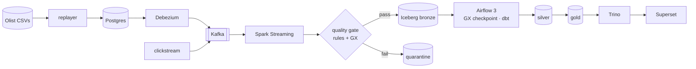
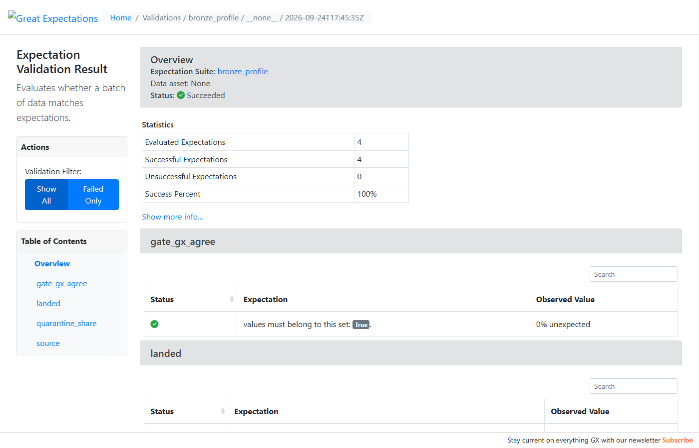
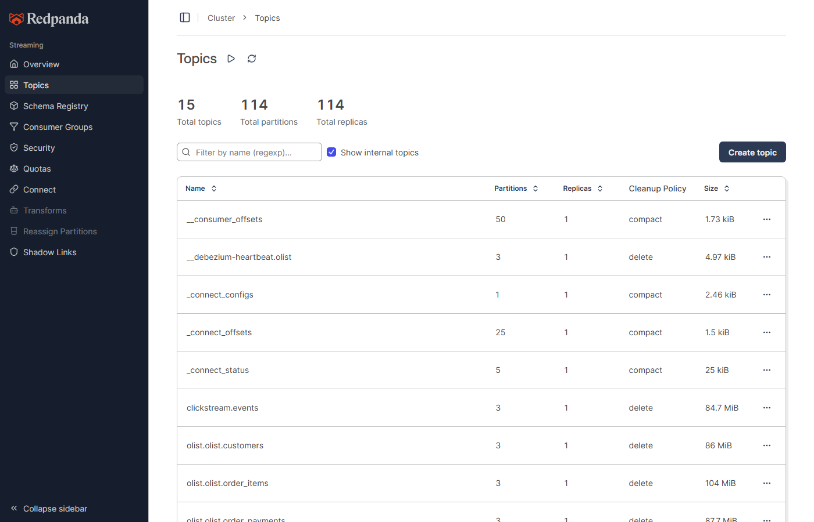
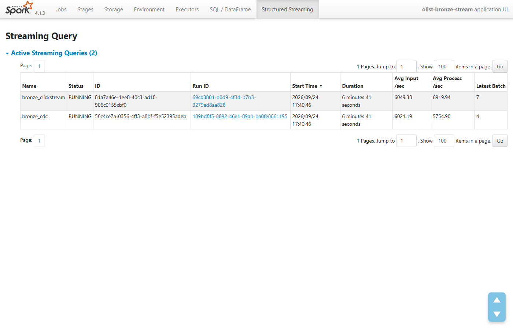
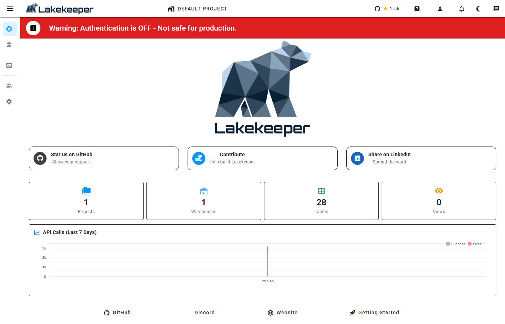

# olist-lakehouse

A local, one-command data platform built on the open-source engines behind the cloud data
services. Real Brazilian e-commerce data (Olist, 2016–2018) is replayed as a live application,
captured with CDC, streamed through Kafka into an Iceberg lakehouse, validated, modeled with dbt,
orchestrated by Airflow, and served through Trino and Superset.

**One command, from a clean clone:** `.\make.ps1 demo` fetches the data, starts 25 services,
replays 866,582 source events, streams them through every layer, builds silver and gold in
Airflow, and then proves it with 9 end-to-end checks. The last clean-clone run took
**7.7 minutes** with the Docker images already built (the first build downloads several GB)
and passed all 9, recorded in
[automation/runs/m5-s2/demo.json](automation/runs/m5-s2/demo.json).



The full diagram, and what each layer promises and how that is checked:
[docs/architecture.md](docs/architecture.md).

## What the demo proves

| Check | Result on the last clean run |
|---|---|
| Services | 25 services: every long-running one healthy, every one-shot exited 0 |
| Replay | 866,582 / 866,582 events; the clickstream covered 99,441 / 99,441 orders |
| Bronze, exactly once | 2,088,157 Kafka offsets = 2,088,157 landed rows = 2,088,157 distinct offsets |
| Quality gate | quarantine = chaos ledger for all 6 rules (e.g. `unknown_status` 4,870 = 4,870) |
| Gate vs Great Expectations | agree on every micro-batch |
| Silver | equals Postgres on all 9 tables, every live row and column (559,365 rows) |
| Gold | payments 16,008,872.12 BRL = the raw CSV to the cent; every order has its ECB rate |
| Airflow | `lakehouse_build` succeeded, every task on its first try |
| Superset | 4 dashboards, 11 charts, every one returns rows |

Along the way:
- Failure drills (kill Connect, kill Spark, restart Kafka) lose nothing and duplicate nothing.
- SCD2 history in gold equals the replayer's mutations.
- A planted failing expectation stops the build, and Data Docs show why.

## Quickstart (Windows, Docker Desktop, uv, Kaggle CLI configured)

```powershell
.\make.ps1 demo              # everything below, unattended, then the 9 checks
.\make.ps1 check              # lint, types, unit tests
.\make.ps1 fetch              # Olist CSVs from Kaggle, verified against data/olist.sha256
.\make.ps1 up                 # generates .env, runs the preflight, starts the stack
.\make.ps1 replay             # replayer + clickstream producer (REPLAY_SPEED, CHAOS_RATE)
.\make.ps1 test-integration   # lake round trip, replayer, CDC, clickstream, bronze, gate
.\make.ps1 gate-redteam       # plant one defect per quality rule; each must be refused by name
.\make.ps1 drills             # kill Connect / kill Spark / restart Kafka; zero loss
.\make.ps1 fx                 # ECB BRL->USD rates into bronze
.\make.ps1 dbt build          # silver + gold, with tests
.\make.ps1 reconcile          # silver vs Postgres, every row and column
.\make.ps1 superset-build     # rebuild the dashboards via the API, export to superset/dashboards
```

| Service | URL |
|---|---|
| Trino | http://localhost:28090 |
| Lakekeeper UI | http://localhost:28181/ui |
| MinIO console | http://localhost:29001 |
| Kafka (Redpanda Console) | http://localhost:28080 |
| Spark (Structured Streaming) | http://localhost:24040 |
| Airflow | http://localhost:28082 (admin / `AIRFLOW_ADMIN_PASSWORD` in `.env`) |
| Superset | http://localhost:28088 (admin / `SUPERSET_ADMIN_PASSWORD` in `.env`) |
| Great Expectations Data Docs | http://localhost:28089 |
| Postgres (the Olist app) | 127.0.0.1:25432, db `olist` |

## Screenshots

| | |
|---|---|
|  |  |
| Great Expectations Data Docs: the bronze checkpoint before a build | Kafka topics, one per source table plus the clickstream |
|  |  |
| Spark Structured Streaming: the CDC and clickstream queries | Lakekeeper, the Iceberg REST catalog: 28 tables |

## Operating it

Operating the platform: [docs/RUNBOOK.md](docs/RUNBOOK.md) and
[docs/FAILURE_DRILLS.md](docs/FAILURE_DRILLS.md). Decisions are in [docs/adr/](docs/adr/) and
known traps in [docs/gotchas.md](docs/gotchas.md).

## Data

Olist Brazilian E-Commerce Public Dataset, © Olist, licensed
[CC BY-NC-SA 4.0](https://creativecommons.org/licenses/by-nc-sa/4.0/). The CSVs are downloaded
at runtime from Kaggle and are never committed to this repository.

## License

Code: MIT (see [LICENSE](LICENSE)). The dataset keeps its own license, above.
